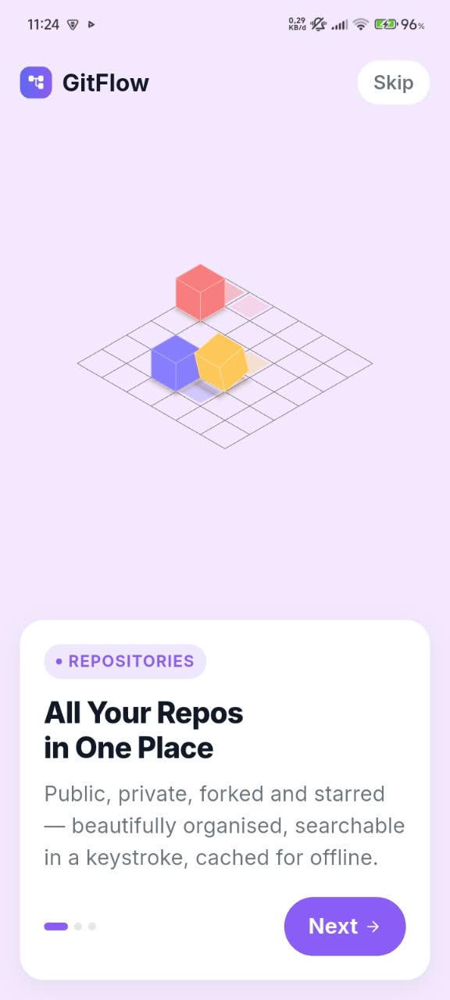
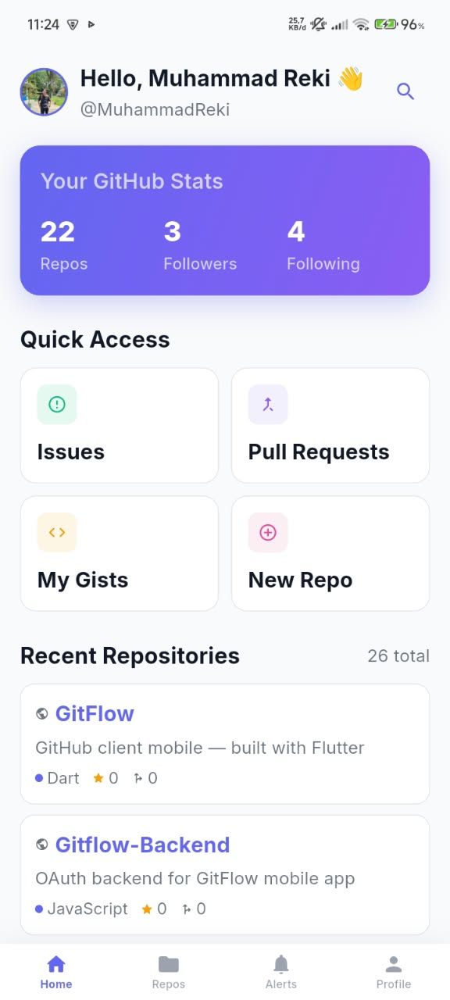
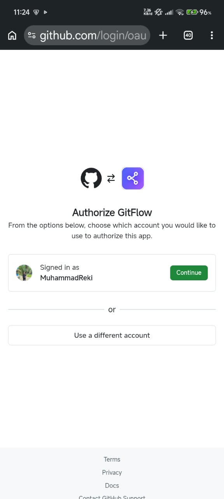

<div align="center">


# GitFlow

**GitHub client mobile — built with Flutter**

[](https://flutter.dev)
[](https://dart.dev)
[](LICENSE)

</div>

---

## 📥 Download

<div align="center">


**Scan QR Code di atas** atau [**klik di sini buat download APK**](https://github.com/MuhammadReki/GitFlow/releases/download/v1.0.0/GitFlow-Mobile.apk)

</div>

---

## 📸 Screenshots

<div align="center">

| Splash | Onboarding | Login |
|:------:|:----------:|:-----:|
|  |  |  |

| Home | Repos | Profile |
|:----:|:-----:|:-------:|
|  |  |  |

</div>

---

## ✨ Fitur

- 🔐 **Login** — GitHub OAuth, Google OAuth, Personal Access Token
- 📦 **Repo** — Browse, search, filter, star, fork, create, delete
- 🐛 **Issues** — Create, edit, comment, close, reopen
- 🔀 **PRs** — Create, review, merge, comment
- 📝 **Commits** — History, diff viewer, comment
- 🔔 **Notifications** — Filter, mark as read
- 👤 **Profile** — Edit, followers, following, starred repos
- 🎨 **Theme** — Light / Dark / System
- 📋 **Lainnya** — Gists, Releases, Actions, Code Search, Branches

---

## 🛠 Tech Stack

`Flutter` · `Dart` · `GoRouter` · `Dio` · `Provider` · `flutter_secure_storage` · `app_links` · `Lottie` · `Vercel`

---

## 🚀 Cara Install

1. Scan QR code di atas atau download APK dari [**Releases**](https://github.com/MuhammadReki/GitFlow/releases)
2. Buka file APK di HP
3. Aktifin "Install from unknown source" kalau muncul warning
4. Install & buka
5. Login pakai GitHub / Google / PAT

**Build dari source:**

```bash
git clone https://github.com/MuhammadReki/GitFlow.git
cd GitFlow
flutter pub get
flutter run